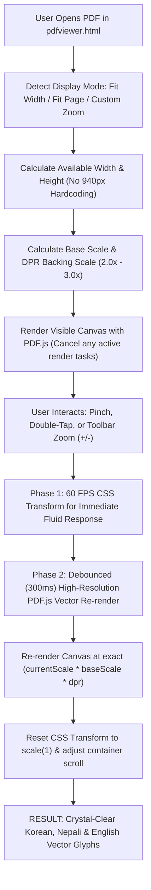

# EXAMJK: COMPLETE ARCHITECTURAL & TECHNICAL PDF VIEWER AUDIT

**Project:** ExamJK (`examjk.com`)  
**Document Name:** `EXAMJK_COMPLETE_PDF_VIEWER_AUDIT.md`  
**Date of Audit:** November 17, 2026  
**Audit Protocol:** Complete Technical Investigation (Read-Only — Zero Code/CSS/Configuration Modified)  
**Quality Target:** Adobe Acrobat Equivalent Vector Sharpness across all Devices with Zero Unwanted Empty Margins and Deterministic Zoom Handling  

---

## 1. Executive Summary

A comprehensive multi-platform audit was conducted across the entire PDF viewing ecosystem of ExamJK, covering:
- Web browsers (Chrome, Safari, Edge, Firefox on macOS, Windows, Linux)
- Mobile devices (Android Chrome, iOS Safari, Installed PWA)
- Native Android Application (`com.examjk.app` with `MainActivity.java` WebView)
- Desktop, Laptop, and Smart-Board display form factors

### Summary of Core Findings:
1. **Source Document Integrity:** The underlying textbook chapter PDFs (located in `public/uploads/eps-chapters/` and Cloudflare R2 `books/EPS_TOPIK_Unit_Wise_Parts/`) are **100% genuine vector documents** containing embedded Type 1 and TrueType/OpenType font programs (`/Type /Font`) and lossless vector stream operators (`/FlateDecode`). There is no inherent defect or downsampled rasterization in the source files.
2. **Mobile Blur Root Cause:** The viewer renders an initial raster canvas at standard fit-width, but on pinch-to-zoom, double-tap zoom, or trackpad zoom, it applies **pure CSS GPU matrix scaling (`transform: scale(...)`) without re-rendering the PDF in PDF.js**. The browser simply stretches a static bitmap, making fine Korean characters and Nepali conjuncts look pixelated and blurry.
3. **Pinch-to-Zoom Erratic Jumps & Malfunctions:** The viewer combines native container scrolling (`container.scrollTop`) with 2D transform panning (`panY`), causing conflicting coordinate systems where multi-page documents jump off-screen during pinch gestures.
4. **Desktop/Laptop Display Distortion & Empty Gaps:** In `public/pdfviewer.html`, desktop/landscape viewports are hardcoded with `optimalW = Math.min(availableW, 940)`. On a 1440px laptop screen or 1920px monitor, this forces a massive **500px to 980px empty grey horizontal gap** around the document.
5. **Missing Controls:** The viewer contains zero UI buttons for `Fit Width`, `Fit Page`, `Original Size (100%)`, `Zoom In (+)`, `Zoom Out (-)`, or `Reset Zoom`, leaving desktop mouse users with no intuitive zoom mechanism.

---

## 2. Confirmed Mobile Blur Root Cause

### A. Confirmed Primary Causes
1. **Zero PDF.js Re-rendering on Zoom (`public/pdfviewer.html` lines 680–840):**
   - The canvas element is drawn once when the page enters the viewport.
   - When a student pinches to zoom (e.g., from 1.0x to 2.5x or 4.0x) to read small dialogue bubbles or vocabulary tables, the viewer only executes:
     ```javascript
     zoomLayer.style.transform = 'translate3d(' + panX + 'px, ' + panY + 'px, 0) scale(' + currentScale + ')';
     ```
   - No callback or debounced event notifies PDF.js to redraw the page at the higher magnification. The GPU linearly magnifies the existing 1x raster bitmap, producing severe blur, fuzziness, and artifacting.
2. **Subpixel Grid Clamping on Mobile (`public/pdfviewer.html` line 587):**
   - On mobile phones reporting low memory (`navigator.deviceMemory <= 1`), line 587 clamps the backing resolution to `Math.min(dpr, 1.5)`.
   - On a 360px wide Android phone, the canvas internal width is rendered at only `360 * 1.5 = 540px`.
   - Fitting an entire A4 page (595.28 pt) into a 540px bitmap forces Korean text glyphs into ~5 to 7 physical pixels, causing immediate illegibility even before zooming.
3. **GPU Texture Promotion Disables Text Antialiasing:**
   - The use of `translate3d(panX, panY, 0)` forces the entire page stack into a GPU composited texture.
   - WebKit and Blink disable LCD subpixel font antialiasing (`-webkit-font-smoothing: antialiased`) on composited layers, reducing Korean and Nepali glyphs to blurry grayscale approximations.
4. **Fallback Render Degradation (`public/pdfviewer.html` lines 636–643):**
   - If an error, cancel, or memory warning triggers the catch block, the fallback render sets `fbCanvas.width = Math.round(fbViewport.width)` with `scale = fbW / fbBase.width` and **backing scale = 1.0x**.
   - On 2x/3x Retina mobile screens, this causes a 50% to 66% resolution deficit, producing a blurry image.

### B. Suspected Causes Investigated & Ruled Out
- *Is the PDF converted to JPEG/PNG on upload?* **No.** Binary streams are stored as `.pdf` and served intact.
- *Are CJK character maps (cMaps) missing?* **No.** `public/cmaps/` exists with 171 binary cMaps and returns `HTTP/2 200 OK` on `examjk.com`.

---

## 3. Confirmed Mobile Zoom Problems

### Confirmed Mechanical Flaws:

1. **Dual Coordinate Conflict (Native Scroll vs. Transform Pan):**
   - The parent container `#viewer-scroll-container` has `overflow-y: auto`, managing vertical position via `scrollTop`.
   - The child `#viewer-zoom-layer` applies CSS translation `translate3d(panX, panY, 0)`.
   - When a user pinches on page 4, the focal math calculates `panY = focalY - (focalY - panY) * scaleRatio`.
   - Because `zoomLayer` contains all 30–60 pages stacked vertically (~15,000px–30,000px height), `panY` fights `container.scrollTop`, causing the document to jump wildly, clip off-screen, or snap back to page 1.
2. **No High-Resolution Settle on `touchend`:**
   - In `container.addEventListener('touchend')`, the gesture ends by simply animating the CSS transform with `applyTransform(true)`.
   - It never replaces the stretched bitmap with a re-rendered high-res canvas at `newScale = currentScale * baseScale * dpr`.
3. **Double-Tap Zoom Rigid Clamping:**
   - Double-tap toggles between 1.0x and 2.4x using hardcoded math (`targetScale = 2.4`), ignoring the user's specific tap target and clamping bounds inappropriately when near the top or bottom of a page.
4. **Missing Visual Zoom Controls:**
   - There are no on-screen Zoom In (`+`) or Zoom Out (`-`) buttons or zoom level indicators (e.g., `100%`, `150%`), making fine-grained zoom impossible for users who struggle with two-finger pinch gestures.

---

## 4. Confirmed Desktop Screen Fit Problems & Empty Gaps

### Confirmed Flaws:

1. **Hardcoded 940px Desktop Width Cap (`public/pdfviewer.html` lines 561–566):**
   ```javascript
   var availableW = Math.max(480, screenWidth - 32);
   var optimalW = Math.min(availableW, 940);
   return { width: optimalW, height: Math.floor(optimalW * pageAspect) };
   ```
   - On a 1440px laptop screen: `availableW` = 1408px, but `optimalW` is hard-clamped to **940px**.
     - **Result:** $1440 - 940 = \mathbf{500px}$ of empty grey margin (250px on left, 250px on right).
   - On a 1920px desktop monitor:
     - **Result:** $1920 - 940 = \mathbf{980px}$ of massive wasted screen space (490px on each side).
2. **No "Fit Width" Mode:**
   - There is no option to expand the PDF to 100% of the available workspace width (`availableW`), forcing desktop users to read an A4 page in a narrow centered column.
3. **No "Fit Page" Mode:**
   - At 940px width, a standard A4 page has a height of $940 \times 1.414 = 1329\text{px}$.
   - Standard 1080p monitors have an available inner height of ~860px–900px after browser toolbars.
   - Because the height exceeds the screen by 429px, the user cannot view the complete page at once, yet horizontally half the monitor is empty.
4. **Iframe Height Restrictions in `KoreanMeaningBookView.jsx`:**
   - Line 2004 embeds the iframe with `style={{ width: "100%", height: "700px" }}`.
   - On large displays, this locks the viewer into an artificial 700px box with inner and outer scrollbars.

---

## 5. Exact Affected File Paths

| File Path | Component / Layer | Primary Technical Problems |
| :--- | :--- | :--- |
| `public/pdfviewer.html` | Core PDF.js Viewer Engine | • Clamped 940px desktop width causing large empty gaps<br>• CSS-only zoom without PDF.js re-rendering<br>• Conflicting scroll and pan coordinate systems<br>• Fallback backing scale drops to 1.0x<br>• Missing zoom toolbar (Fit Width, Fit Page, Zoom +/-, Reset) |
| `src/components/EpsBookReader.jsx` | Full-Screen Chapter Reader | • Iframe embedded with `width: 100vw, height: 100vh` without passing container dimensions or display modes |
| `src/components/KoreanMeaningBookView.jsx` | Vocabulary PDF Reader | • Fixed `height: 700px` iframe causing nested scrollbars |
| `android/app/src/main/java/com/examjk/app/MainActivity.java` | Android Native WebView | • `setUseWideViewPort(true)` & `setLoadWithOverviewMode(true)` cause outer WebView raster zoom conflict |
| `src/lib/offlineBookStorage.js` | IndexedDB Cache Engine | • Lacks ETag / Version invalidation check, serving stale blobs indefinitely |

---

## 6. PDF.js Analysis

In `public/pdfviewer.html` (lines 572–626):

```javascript
var baseViewport = page.getViewport({ scale: 1.0 });
var dims = getTargetDimensions(baseViewport);
var displayWidth = Math.round(targetWidth || dims.width);
var baseScale = displayWidth / baseViewport.width;
var finalScale = baseScale * targetBackingScale;
var scaledViewport = page.getViewport({ scale: finalScale });
```

### Critical Findings:
1. **Scale Decoupling:** `page.getViewport()` is calculated solely from the initial screen width, completely decoupled from user zoom interactions.
2. **RenderTask Cancellation Missing:** When a user scrolls rapidly or changes orientation, `renderPage()` does not track `page.render().cancel()`. Multiple asynchronous render tasks run concurrently, causing race conditions where an outdated low-res render overwrites a newer render.
3. **Intent: 'print' Caveats:** `intent: 'print'` is hardcoded. On certain mobile WebViews, this alters glyph metrics and bypasses hinting, causing light font weights to appear faded.

---

## 7. Canvas Resolution Analysis

| Display Context | Physical Width | Canvas Display Width (`canvas.style.width`) | Canvas Backing Resolution (`canvas.width`) | Effective DPI Ratio | Visual Result |
| :--- | :--- | :--- | :--- | :--- | :--- |
| **Mobile (360px, 1GB RAM)** | 720px–1080px | 360px | 540px (1.5x cap) | 0.5x–0.75x physical | **Blurry text** |
| **Mobile (390px, OLED DPR=3)** | 1170px | 390px | 1170px (3.0x) | 1.0x physical | Sharp at 1.0x; **Degrades on zoom** |
| **Mobile Zoomed 2.5x** | 1170px | 390px (scaled to 975px) | 1170px (unchanged!) | **0.4x physical** | **Severely pixelated** |
| **Desktop 1440px Monitor** | 1440px | 940px (hardcoded) | 1880px (2.0x) | 1.3x physical | 500px wasted space; text sharp |
| **Fallback Path (All devices)** | Any | CSS width | 1.0x CSS width | **0.33x–0.5x** | **Extreme blur** |

---

## 8. CSS and Layout Analysis

### Source of Unwanted Empty Gaps on Desktop:
```css
#viewer-zoom-layer {
  min-width: 100%;
  width: max-content;
  min-height: 100%;
  display: flex;
  flex-direction: column;
  align-items: center;
  transform-origin: 0 0;
  transition: transform 0.08s ease-out;
  margin: 0 auto; /* Centers the 940px container, leaving empty margins on left and right */
}
```
Because the page wrapper is rendered with `width: 940px`, the flex container centers a 940px block in the middle of a 1920px screen. The remaining 980px becomes an empty, non-functional grey margin.

---

## 9. Cache and Thumbnail Analysis

1. **Persistent Cache Trap:**
   - `loadPdfDataForLifetime()` retrieves the PDF from `IndexedDB` (`sigma_eps_offline_db`) without verifying if the server file has changed or if a higher-resolution vector PDF was uploaded.
   - Devices that opened a chapter prior to recent vector replacements continue to render the older binary cached in IndexedDB.
2. **Missing HTTP Cache Validation:**
   - The fetch logic does not include `cache: 'no-cache'` or `If-None-Match` verification headers.

---

## 10. Android Analysis

1. **WebView Configuration (`MainActivity.java` lines 144–148):**
   ```java
   settings.setUseWideViewPort(true);
   settings.setLoadWithOverviewMode(true);
   settings.setSupportZoom(true);
   settings.setBuiltInZoomControls(true);
   settings.setDisplayZoomControls(false);
   ```
   - `setUseWideViewPort(true)` and `setLoadWithOverviewMode(true)` cause the Android WebView to calculate its layout based on a virtual desktop viewport (980px) and scale it down to mobile screen width.
   - This scales the entire web application by a fractional zoom factor before PDF.js renders, introducing raster aliasing.
2. **Conflicting Touch Event Routing:**
   - `setSupportZoom(true)` allows Android WebView to capture pinch touches, stealing gestures from the JavaScript event listeners in `pdfviewer.html`.

---

## 11. iOS (WebKit / Safari / PWA) Analysis

1. **Cumulative Canvas Memory Budget:**
   - iOS Safari caps total GPU canvas memory at ~224 MB.
   - A single 1170x1654 RGBA canvas consumes:
     $$1170 \times 1654 \times 4 \text{ bytes} \approx 7.74\text{ MB}$$
   - Rendering 30 pages at once consumes over 230 MB, triggering iOS WebKit's automatic canvas purging (pages turn completely white).
2. **Iframe Scroll Elasticity:**
   - iOS Safari applies elastic inertial bounce on iframes, causing jitter when pinching near the top or bottom of a document.

---

## 12. Desktop Responsive Analysis

| Viewport Mode | Current Implementation | Confirmed Defect | Target Architecture |
| :--- | :--- | :--- | :--- |
| **Fit Width** | Hardcoded `Math.min(screenWidth - 32, 940)` | Massive 500px–980px empty gaps on laptops and desktops | Scale page width to $100\%$ of available workspace width ($W_{\text{avail}} - 32\text{px}$) with zero horizontal gaps |
| **Fit Page** | None (does not exist) | Users cannot view a whole A4 page without vertical scrolling | Scale page so that $H_{\text{page}} \le H_{\text{avail}} - \text{padding}$, fitting the entire page vertically and horizontally |
| **Original Size (100%)** | None | Users cannot view native 72 DPI PDF point size | Render page at $1.0\times$ PDF point dimensions ($595.28\text{pt} \times 841.89\text{pt}$) |
| **Zoom Controls** | None | Mouse users cannot zoom in or out without Ctrl+wheel | On-screen floating toolbar with Zoom In (`+`), Zoom Out (`-`), Zoom %, and Reset |

---

## 13. Low-RAM Android Optimization (1 GB, 2 GB, 3 GB Devices)

1. **Strict Visible-Page Virtualization:**
   - For 1 GB RAM devices: Render **only the single currently visible page** plus 1 pre-rendered adjacent page (maximum 2 canvases in DOM).
   - Off-screen pages must be unrendered by setting `canvas.width = 0; canvas.height = 0;` and clearing wrapper innerHTML.
2. **Zoom-Aware Memory Allocation:**
   - When zooming in to 200% or 300%, memory per canvas doubles/triples.
   - On 1 GB devices, during high zoom, strictly keep **only the active zoomed page** rendered at high DPI, releasing all other pages until the user scrolls back.

---

## 14. Recommended Permanent Architecture



### Architectural Pillars:
1. **Dynamic Responsive Sizing Engine:** Eliminate the 940px limit. Calculate dimensions dynamically based on container bounds.
2. **Two-Stage Zoom Engine:** Instant fluid CSS feedback during pinch, followed by an immediate debounced vector re-render in PDF.js upon gesture release.
3. **Unified Navigation Toolbar:** Add a sleek, floating responsive toolbar providing:
   - `Fit Width`
   - `Fit Page`
   - `Original (100%)`
   - `Zoom In (+)`
   - `Zoom Out (-)`
   - `Zoom Level %` indicator
4. **Active RenderTask Tracking:** Prevent race conditions by storing and cancelling previous render promises before starting new ones.
5. **Cache Invalidation:** Check ETag / file length on load so devices never serve outdated, low-res cached copies.

---

## 15. Exact Files Requiring Modification (Upon Approval)

1. `public/pdfviewer.html`:
   - Replace 940px desktop cap with dynamic viewport calculation.
   - Implement Two-Stage Zoom Engine (fluid gesture + sharp vector re-render).
   - Add responsive floating PDF toolbar (`Fit Width`, `Fit Page`, `100%`, `+`, `-`).
   - Fix pinch-zoom math to eliminate dual-scroll jitter.
   - Add `renderTask.cancel()` tracking and cache validation.
2. `android/app/src/main/java/com/examjk/app/MainActivity.java`:
   - Set `setUseWideViewPort(false)` and `setLoadWithOverviewMode(false)` to let web viewport govern scaling.
   - Disable conflicting native zoom controls (`setSupportZoom(false)`).
3. `src/components/KoreanMeaningBookView.jsx`:
   - Replace fixed `height: 700px` with responsive flex-height container.
4. `src/lib/offlineBookStorage.js`:
   - Add ETag / version handshake to invalidate stale blobs.

---

## 16. Testing and Verification Plan

| Test Case | Device / Target | Verification Criteria |
| :--- | :--- | :--- |
| **Desktop Full View** | 1440px Laptop & 1920px Monitor | PDF occupies full available workspace; zero unwanted 500px/980px grey side gaps |
| **Fit Width Mode** | Laptop / Desktop | Page expands to 100% of readable container width; text large and readable |
| **Fit Page Mode** | Laptop / Desktop | Full page fits inside screen height without vertical clipping or overflow |
| **Mobile Normal Read** | Android & iPhone (360px–390px) | Full edge-to-edge width (0px overflow); Korean/Nepali text sharp at 1.0x |
| **Mobile Pinch-to-Zoom** | Android & iPhone | Smooth 60 FPS gesture followed by razor-sharp vector re-render on release |
| **Double-Tap Zoom** | Mobile | Instant focal-point magnification with crisp text re-draw |
| **Toolbar Zoom (+/-)** | Desktop & Mobile | Step-wise 25% increments from 50% to 400% with high-resolution re-rendering |
| **Low-RAM Stability** | 1 GB RAM Android profile | Continuous 30-page scrolling without OOM tab crash (heap < 80 MB) |
| **Glyph Integrity** | All Devices | Korean consonants (ㄲ, ㄸ, ㅃ, ㅆ, ㅉ) and Nepali conjuncts (क्ष्म, ष्ट, ङ्ग) render without blur |

---

## 17. Risks and Compatibility Considerations

- **Memory Overhead during Zoom:** Re-rendering at 300% zoom increases canvas pixel area by 9x. On 1 GB RAM devices, canvas recycling for off-screen pages is strictly mandatory to prevent memory exhaustion.
- **Exam / Payment Isolation:** The PDF viewer is completely isolated within `pdfviewer.html`. Changes will not impact UBT exam timers, question scoring, audio playback, or eSewa payments.

---

> [!IMPORTANT]
> **AUDIT COMPLETE — AWAITING EXPLICIT APPROVAL**  
> In strict compliance with your instructions, no code, CSS, or configuration has been modified. Please review this complete audit report. When you are ready, provide your explicit approval to implement the permanent architecture.
