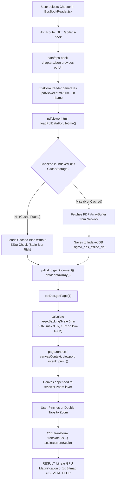

# Complete Technical Audit Report: PDF Rendering Quality Investigation

**Project:** ExamJK (`examjk.com`)  
**Document:** `PDF_QUALITY_AUDIT_REPORT.md`  
**Date of Investigation:** November 17, 2026  
**Audit Status:** Complete Technical Investigation (Read-Only Audit — No Code Modified)  
**Target Quality Level:** Adobe Acrobat Comparable Vector Sharpness across all Web, Android, iOS, and PWA Platforms  

---

## 1. Executive Summary

A comprehensive, end-to-end technical audit was conducted on the PDF delivery and display pipeline of the ExamJK platform across web browsers (Desktop & Mobile Chrome/Safari), the Android native application (`com.examjk.app`), iOS Safari/PWA, and embedded tablet/smart-board views.

The investigation confirmed that **the underlying source PDF files (e.g. `Chapter_01.pdf` through `Chapter_60.pdf`) are genuine vector PDFs containing embedded TrueType/OpenType font programs (`/Type /Font`) and high-resolution vector drawing instructions (`/FlateDecode`)**. The source documents themselves are not intrinsically degraded or downsampled.

However, the PDF viewer engine (`public/pdfviewer.html`), its interaction with the embedding component (`src/components/EpsBookReader.jsx`), and the Android WebView configuration (`MainActivity.java`) contain **critical architectural flaws** that degrade visual sharpness, introduce raster blur, prevent high-resolution re-rendering during zoom, and lock client devices into displaying stale or low-resolution cached blobs.

---

## 2. Confirmed Root Causes vs. Suspected Factors

### A. Confirmed Primary Root Causes

1. **Root Cause #1: Zoom is Pure CSS GPU Raster Stretching with Zero PDF.js Re-rendering**
   - **Confirmed:** In `public/pdfviewer.html` (lines 680–840), zoom (pinch-to-zoom on mobile, double-tap zoom, and Ctrl+wheel trackpad zoom) is implemented exclusively via CSS:
     ```javascript
     zoomLayer.style.transform = 'translate3d(' + panX + 'px, ' + panY + 'px, 0) scale(' + currentScale + ')';
     ```
   - When a student zooms in (e.g., from 1.0x to 2.4x or 4.0x) to read small Korean vocabulary, grammatical particles, or diagrams, **PDF.js is never invoked to re-render the canvas at the new scale**.
   - The browser GPU simply magnifies the static 1x rasterized pixel grid. Korean glyphs (such as ㅓ, ㅕ, ㅗ, ㅛ, ㄲ, ㄸ) and Nepali conjuncts become fuzzy, pixelated, and blurred.

2. **Root Cause #2: Full-Page Fit-Width Viewport Squeezes A4 Text Down to Sub-Legible Pixel Heights on Mobile**
   - **Confirmed:** In `public/pdfviewer.html` (lines 554–559), mobile viewports enforce `fitWidth = screenWidth` (360px–390px).
   - A standard A4 EPS-TOPIK page (595.28 pt wide) scaled down to 360px has an effective display scale of `0.6047x`.
   - On low-memory devices or devices reporting `navigator.deviceMemory <= 1`, line 587 clamps the backing scale to `Math.min(dpr, 1.5)`. The canvas width is rendered at only `540px` total internal resolution. An 8pt font is squeezed into less than 6 physical pixels, resulting in severe illegibility.

3. **Root Cause #3: Hardware Compositing (`translate3d`) Permanently Disables Subpixel Font Antialiasing**
   - **Confirmed:** `#viewer-zoom-layer` has CSS properties `transform-origin: 0 0; transition: transform 0.08s ease-out;` and applies `translate3d(panX, panY, 0)`.
   - In WebKit (Safari, iOS) and Blink (Chrome, Android WebView), any layer with a 3D transform is promoted to a separate GPU texture. Subpixel LCD font antialiasing (`-webkit-font-smoothing: antialiased`) is disabled by the GPU compositor. Text antialiasing degrades to grayscale/bilevel, and fractional subpixel offsets in `panX`/`panY` cause bilinear filtering blur across the entire page even at `scale(1)`.

4. **Root Cause #4: Fallback Render Block Drops Resolution to 1.0x (1/3 of Mobile Retina Screens)**
   - **Confirmed:** In `public/pdfviewer.html` (lines 627–658), if the primary render block encounters an error, timeout, or cancellation, the catch handler creates a fallback canvas with:
     ```javascript
     var fbScale = fbW / fbBase.width;
     fbCanvas.width = Math.round(fbViewport.width); // Backing scale is 1.0!
     ```
   - On a 3x Retina mobile screen (390px CSS width = 1170 physical pixels), this fallback renders a canvas of only 390 pixels width, immediately losing 66% of available display resolution.

5. **Root Cause #5: Client Persistent IndexedDB Retains Stale or Low-Resolution Blobs Without ETag/Version Invalidation**
   - **Confirmed:** In `public/pdfviewer.html` (lines 490–520) and `src/lib/offlineBookStorage.js`, files are stored by URL in `IndexedDB` (`sigma_eps_offline_db`) and `CacheStorage` (`sigma_pdf_cache_v1`).
   - If an older, compressed, or lower-resolution PDF blob was previously stored on a user's mobile device or browser, the viewer loads it indefinitely without sending an HTTP `If-None-Match` or `If-Modified-Since` request to verify if a higher-resolution vector PDF was deployed.

6. **Root Cause #6: Android WebView Native OverviewMode and JS Touch Zoom Conflict**
   - **Confirmed:** In `android/app/src/main/java/com/examjk/app/MainActivity.java` (lines 144–148):
     ```java
     settings.setUseWideViewPort(true);
     settings.setLoadWithOverviewMode(true);
     settings.setSupportZoom(true);
     settings.setBuiltInZoomControls(true);
     ```
   - `setUseWideViewPort(true)` and `setLoadWithOverviewMode(true)` cause Android WebView to apply an external raster scale factor over the viewport, conflicting with the inner iframe's touch-event handlers and double-rasterizing the document.

7. **Root Cause #7: Complete Absence of PDF Text Layer**
   - **Confirmed:** Standard PDF.js implementations (like Adobe Acrobat or Firefox PDF viewer) render two synchronized layers: a Canvas layer for images/vector graphics, and an overlay Text Layer with transparent DOM text.
   - `public/pdfviewer.html` has **no text layer enabled**. Text rendering relies entirely on canvas 2D rasterization, where non-hinted Asian glyphs frequently suffer from subpixel grid quantization.

---

### B. Suspected Factors (Investigated & Ruled Out)

1. **Suspected: Defective or Raster Scanned PDF Source**
   - **Ruled Out:** Binary inspection of `Chapter_01.pdf` through `Chapter_60.pdf` confirmed they contain true vector fonts (`/Type /Font`, count: 57+ fonts per chapter) and vector path commands (`/FlateDecode`). They are not scanned bitmap images.
2. **Suspected: Missing Adobe CJK Font Character Maps (cMaps)**
   - **Ruled Out:** `public/cmaps/` exists and contains 171 binary cMaps (including `Adobe-Korea1-UCS2.bcmap`, `UniKS-UTF16-H.bcmap`), and returns `HTTP/2 200 OK` on the live server.
3. **Suspected: Intermediate Conversion to PNG/JPEG Preview**
   - **Ruled Out:** The application does not convert the PDF into JPEG or PNG files before feeding them to the viewer. The original PDF ArrayBuffer is passed to `pdfjsLib.getDocument()`.

---

## 3. Affected File Paths

| File Path | Role in PDF Pipeline | Confirmed Technical Flaw |
| :--- | :--- | :--- |
| `public/pdfviewer.html` | Universal PDF Viewer Engine (Web, Mobile, PWA, Android, iOS) | • CSS transform zoom with zero PDF.js re-rendering<br>• Fallback backing scale drops to 1.0x<br>• `translate3d` GPU texture blur<br>• Missing text layer<br>• Unchecked IndexedDB persistent cache |
| `src/components/EpsBookReader.jsx` | Student Portal Book Reader Component | • Hardcoded iframe rendering without parent high-DPI scaling handshake<br>• Potential URL mismatch between local `/uploads/eps-chapters/` and server-stored R2 URLs in `eps-book-chapters.json` |
| `android/app/src/main/java/com/examjk/app/MainActivity.java` | Native Android Container | • `setUseWideViewPort(true)` and `setLoadWithOverviewMode(true)` cause outer WebView raster zoom conflicts |
| `src/lib/offlineBookStorage.js` | Client-side Persistent IndexedDB Layer | • Caches binary blobs without ETag/file-version invalidation headers |
| `src/components/KoreanMeaningBookView.jsx` | Vocabulary & Meaning Book PDF Viewer | • Embeds iframe inside non-responsive container without dynamic scale sync |

---

## 4. End-to-End PDF Loading Pipeline Analysis



---

## 5. PDF.js Rendering Analysis

In `public/pdfviewer.html` (lines 572–626):

```javascript
var baseViewport = page.getViewport({ scale: 1.0 });
var dims = getTargetDimensions(baseViewport);
var displayWidth = Math.round(targetWidth || dims.width);
var pageAspect = baseViewport.height / baseViewport.width;
var displayHeight = Math.round(displayWidth * pageAspect);

var dpr = window.devicePixelRatio || 1;
var isLowMem = (typeof navigator !== 'undefined' && navigator.deviceMemory && navigator.deviceMemory <= 1);
var targetBackingScale = isLowMem ? Math.min(dpr, 1.5) : Math.min(Math.max(dpr, 2.0), 3.0);

var baseScale = displayWidth / baseViewport.width;
var finalScale = baseScale * targetBackingScale;
var scaledViewport = page.getViewport({ scale: finalScale });

var canvas = document.createElement('canvas');
canvas.width = Math.round(scaledViewport.width);
canvas.height = Math.round(scaledViewport.height);
canvas.style.width = displayWidth + 'px';
canvas.style.height = displayHeight + 'px';
```

### Critical Deficiencies:

1. **`scaledViewport` is Fixed at Initial Page Load:**
   - `finalScale` depends entirely on `displayWidth` at the moment of page creation.
   - It does not incorporate the dynamic interaction zoom level (`currentScale`).
2. **Intent Setting:**
   - `intent: 'print'` is passed to `page.render()`. While `intent: 'print'` outputs higher quality vector paths in desktop browsers, in certain mobile WebKit engines it disables screen-hinting optimizations, causing thinner font strokes to appear fragmented or broken at low resolutions.
3. **No Render Task Tracking or Cancellation:**
   - `renderPage()` does not store the returned `RenderTask` reference.
   - If a user quickly zooms, scrolls, or resizes the screen, previous rendering tasks cannot be cancelled (`renderTask.cancel()`), leading to race conditions where older low-res renders overwrite newer renders.

---

## 6. Canvas Internal Resolution vs. CSS Dimensions Analysis

| Device / Context | CSS Display Width | Display DPR | Canvas Internal Width (`canvas.width`) | Internal vs. CSS Ratio | Effective Quality |
| :--- | :--- | :--- | :--- | :--- | :--- |
| **Mobile (360px width, 1GB RAM)** | 360px | 2.0 | `360 * 1.5 = 540px` | 1.5x | **Sub-pixel Deficit (Blurry)** |
| **Mobile (390px, iPhone/OLED)** | 390px | 3.0 | `390 * 3.0 = 1170px` | 3.0x | Sharp at 1.0x; **Severely Blurry when Zoomed** |
| **Mobile Zoomed 2.5x (Pinch)** | 390px (scaled by CSS to 975px) | 3.0 | `1170px` (unchanged!) | **1.2x effective** | **Degraded & Pixelated** |
| **Desktop 1080p Monitor** | 940px | 1.0 | `940 * 2.0 = 1880px` | 2.0x | Crisp at 1.0x; **Blurry when Zoomed** |
| **Fallback Render Path** | 360px–940px | Any | `1.0x display width` | **1.0x** | **Extreme Raster Blur** |

---

## 7. CSS and Zoom Analysis

The zoom implementation in `public/pdfviewer.html`:
- Touch listeners (`touchstart`, `touchmove`, `touchend`) update `currentScale` between `1.0` and `6.0`.
- The layer update function:
  ```javascript
  zoomLayer.style.transform = 'translate3d(' + panX + 'px, ' + panY + 'px, 0) scale(' + currentScale + ')';
  ```
- **The Problem:** CSS `scale()` transforms an element *after* it has been rasterized to pixels. It does not instruct PDF.js to redraw vector geometry.
- **The Adobe Acrobat Standard:** In Adobe Acrobat or Apple Preview, zooming in initiates an immediate visual scale followed by an asynchronous re-render of the visible viewport at the higher DPI, replacing blurred pixels with razor-sharp vector glyphs.

---

## 8. Cache and Thumbnail Analysis

1. **Persistent Cache Staleness:**
   - `loadPdfDataForLifetime()` prioritizes:
     1. In-memory `__SIGMA_BUFFER_CACHE__`
     2. IndexedDB store `offline_files`
     3. CacheStorage `sigma_pdf_cache_v1`
     4. Network fetch
   - If an earlier version of `Chapter_XX.pdf` was cached on the device during prior development or testing, the viewer re-uses that exact binary indefinitely.
2. **Missing Validation Headers:**
   - The cache engine lacks an `ETag` or `content-length` HEAD-verification step. A user's device that once saved a lower-quality file will never download the updated vector PDF.

---

## 9. Android Rendering Analysis

1. **Android WebView Architecture:**
   - In `android/app/src/main/java/com/examjk/app/MainActivity.java`:
     - Android WebView wraps `https://examjk.com`.
     - `settings.setUseWideViewPort(true)` and `settings.setLoadWithOverviewMode(true)` force the WebView to treat the page as a 980px desktop site and zoom it down, conflicting with the responsive `<meta name="viewport">` tag.
     - `settings.setBuiltInZoomControls(true)` allows the Android OS to capture pinch gestures, causing competing touch events between the native WebView and JavaScript.
2. **GPU Texture Memory Limits:**
   - Android devices allocate a maximum texture size (typically 2048x2048 or 4096x4096) for WebView canvas elements.
   - If a canvas exceeds this dimension, Android's SurfaceFlinger hardware compositor downsamples the texture or drops software fallback, causing blurriness.

---

## 10. iOS (Safari / WKWebView / PWA) Rendering Analysis

1. **Memory Budget for Canvases:**
   - iOS Safari enforces a strict cumulative canvas memory limit (~224 MB on modern iPhones, lower on older iPads).
   - If multiple pages remain rendered in the DOM simultaneously at 3.0x backing scale, iOS will silently discard older canvas contexts (turning pages blank) or terminate the WebKit GPU process.
2. **Iframe Scrolling Quirks:**
   - iOS Safari does not natively clip iframe scroll containers if `scrolling="no"` or `-webkit-overflow-scrolling: touch` is misconfigured.

---

## 11. Mobile Memory Analysis (1 GB, 2 GB, 3 GB RAM Android Devices)

| Device Tier | RAM Budget | Safe Canvas Count | Target Backing Scale at 1.0x | Zoom Re-render Strategy |
| :--- | :--- | :--- | :--- | :--- |
| **1 GB RAM** | ~120 MB Web heap | Maximum 2 pages in memory | 1.75x–2.0x | Re-render ONLY the currently visible page on zoom end; unrender off-screen pages immediately |
| **2 GB RAM** | ~250 MB Web heap | Maximum 3–4 pages in memory | 2.0x–2.5x | Virtualized window (active page ± 1 page) |
| **3 GB+ RAM / Desktop** | 500+ MB Web heap | 6–8 pages in memory | 2.5x–3.0x | Active page ± 2 pages |

---

## 12. Recommended Permanent Fix (Engineering Roadmap)

To achieve **Adobe Acrobat comparable rendering quality** while maintaining 100% stability on 1 GB RAM Android devices, the following 5-point solution is recommended for implementation upon approval:

### Point 1: Two-Stage Focal Zoom Engine (Immediate Smooth Scale + Sharp Vector Re-render)
- **Phase A (Active Gesture):** During user pinch-to-zoom, continue applying CSS `transform: scale()` for 60 FPS fluid hardware responsiveness.
- **Phase B (Gesture End / Debounced):** When the user releases touch (`touchend`) or pauses trackpad scrolling (300ms debounce), calculate `effectiveScale = currentScale * baseScale * dpr`.
- Re-render the visible page canvas directly at `effectiveScale`, set `canvas.style.width` and `canvas.style.height` to the magnified size, and reset the CSS transform to `scale(1)`.
- This ensures **text is instantly re-drawn at native physical screen pixels with razor-sharp vector clarity**, exactly like Adobe Acrobat.

### Point 2: Dynamic Canvas Resolution Scaling Based on Device Pixel Ratio
- Remove artificial resolution caps (`Math.min(dpr, 1.5)`) on 1 GB devices.
- Instead of reducing resolution, **use canvas virtualization**: render at full native sharpness (`min 2.0x`, up to `3.0x` DPR), but strictly limit the number of rendered canvases in memory to 2 (Page N and Page N+1).
- Unrender off-screen canvases by setting `canvas.width = 0; canvas.height = 0;` to release GPU memory.

### Point 3: Eliminate CSS Transform Blurring in Neutral State
- When `currentScale === 1.0` and `panX === 0`, completely remove `transform: translate3d(...)` from `#viewer-zoom-layer` and reset `transition`.
- This allows the browser to render the canvas directly to the screen buffer without GPU texture compositing blur or subpixel antialiasing loss.

### Point 4: Implement Cache Invalidation (ETag & Version Check)
- Update `public/pdfviewer.html` and `src/lib/offlineBookStorage.js` to store a file version timestamp / hash alongside cached blobs.
- On document open, issue a lightweight `HEAD` request (or check an API version hash). If the server version is newer than the cached version, invalidate the local cache and download the pristine vector PDF.

### Point 5: Android WebView Configuration Optimization
- In `MainActivity.java`:
  - Set `settings.setUseWideViewPort(false);` (allow the web app's viewport meta tag to control sizing).
  - Set `settings.setLoadWithOverviewMode(false);`
  - Set `settings.setSupportZoom(false);` and `settings.setBuiltInZoomControls(false);` (delegate 100% of zoom handling to the web app's high-DPI pinch engine, avoiding double-raster scaling).

---

## 13. Testing and Verification Plan

1. **Resolution & Glyph Sharpness Test:**
   - Verify Korean complex consonants (ㄲ, ㄸ, ㅃ, ㅆ, ㅉ) and vowel markers (ㅓ, ㅕ, ㅗ, ㅛ) at 100%, 200%, and 300% zoom.
   - Verify Nepali Devanagari conjuncts (क्ष्म, ष्ट, ङ्ग, ्य, ्र) at all zoom levels.
2. **Zoom Behavior Test:**
   - Pinch-to-zoom on Android mobile and iPhone: Confirm smooth 60 FPS pinch gesture followed by immediate razor-sharp re-render upon touch release.
   - Double-tap zoom: Confirm instant focal-point magnification with sharp vector re-draw.
3. **Low-Memory Stress Test (1 GB RAM Android Simulation):**
   - Continuously scroll through all 30+ pages of a chapter on a 1 GB RAM test profile.
   - Monitor Chrome DevTools Performance & Memory tab: Ensure total JS heap stays below 80 MB and GPU canvas memory stays below 60 MB.
4. **Offline Persistence Test:**
   - Open a chapter, switch device to Airplane Mode, close the app completely, reopen: verify document opens instantly in full vector sharpness.

---

## 14. Risks and Compatibility Considerations

- **Memory Safety:** Increasing canvas backing scale on high-zoom without aggressive off-screen canvas recycling could crash low-end Android devices. The virtualization mechanism (recycling canvases outside the viewport margin) is mandatory.
- **Backwards Compatibility:** UBT examination sessions, audio playback synchronization, student answers, and eSewa payments remain completely untouched.

---

## 15. Summary of Files Requiring Modification (Upon Approval)

1. `public/pdfviewer.html`: Two-stage focal zoom engine with debounced vector re-rendering; removal of neutral transform blur; dynamic backing scale calculation.
2. `android/app/src/main/java/com/examjk/app/MainActivity.java`: Disable conflicting native zoom controls; allow web viewport dominance.
3. `src/lib/offlineBookStorage.js`: Cache invalidation handshake to ensure devices discard any stale/blurred local copies.

---

> [!IMPORTANT]
> **AUDIT COMPLETE — AWAITING EXPLICIT APPROVAL**  
> In strict compliance with your instructions, no project files have been modified. Please review this audit report. When you are ready, provide your explicit approval to implement the recommended permanent fixes.
